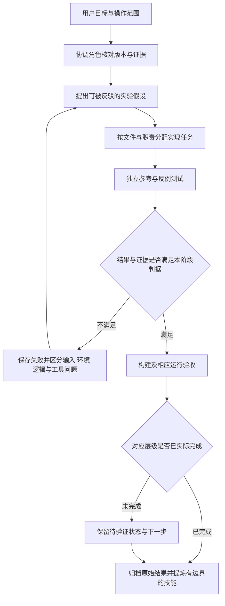

# 大模型协作开发、证据核验与工程复现报告

**项目：AX7020 鸟类识别与音视融合云台**  
**整理日期：2026-11-03**  
**对象：基于 SSD95 发布版本的功能目录工程包，以及与其相关的历史开发验证过程。**

## 1. 本报告回答什么

本报告说明大模型在本项目中承担了哪些工作，哪些决定由人作出，如何用代码、仿真、构建和实测约束模型的判断，以及错误建议和证据缺口怎样被发现、纠正和记录。它面向接手工程的学生、指导教师和评审，不要求读者先理解 M12、M29 等开发阶段编号。

报告由当前协作过程、包内历史回执、原始板测记录和构建日志交叉整理。它不是完整聊天原文导出，也不将模型后来总结的句子当作用户历史原话。下文标为“可复用提示词”的内容是依据经验归纳的模板。

用户后续补充了由其他智能体整理的历史协作记录。本报告在第 13 章逐项补充“提示词、回答或动作摘述、反证和纠错”，在第 14 章给出智能体工作流的角色、状态、输入输出及失败转移。补充材料的原文、历史事实和本次重新核验的结果分开标注，不把二次整理当作完整聊天转录。

本次可核验的结果以具体文件和对应版本为准。`PASS`、`通过`必须同时带上对象和范围：通过离线存图测试、完成编译、完成时序检查、完成一次板测，是不同层次的事实。文件哈希相同只能证明相应文件一致，不能单独证明功能正确。

## 2. 项目背景与协作分工

系统在 Zynq-7020 上组合四麦声源定位、鸟目标检测、视觉鸟种分类、云台跟随、HDMI 显示、上位机调参及 SD 照片归档。Core0 负责网络、图像服务、识别调度和控制，Core1 负责声音处理及 SD 文件系统写入；PL 负责采集、预处理、显示及神经网络计算相关逻辑。

这类工程的难点不是生成一份能编译的代码，而是使硬件接线、时钟与复位、定点数值约定、双核共享数据、构建产物和现场操作保持一致。大模型能够快速跨文件追踪接口与组织实验，但也可能把不同阶段的事实混在一起，把局部成功扩大为整机成功，或漏掉未被主入口覆盖的测试。

| 参与方 | 主要职责 | 本项目中的可核验体现 |
| --- | --- | --- |
| 用户与现场人员 | 确定目标、机构与接线约束、拍照策略、允许的硬件操作；提供现场现象并验收使用行为 | 要求追踪与拍照门槛分离、保留已有照片、采用 SD 文件日期；确认原摄像头转接板和无编码器约束 |
| 大模型实现工作 | 理解源码、定位生成器与调用链、提出修改、实现脚本及说明、组织测试 | `src/application/tools/` 的功能生成流程、双核构建入口、存图资格测试、目录迁移及复现文档 |
| 大模型审查工作 | 主动寻找反例、运行完整测试、检查证据是否支持结论、记录未完成项 | 发现协议测试向量缺失、GCC 13 声明问题、技能文档“单钟域”陈旧结论及只在缓存中的成功实现策略 |
| 工具与独立参考 | 给出可重复的事实反馈 | GCC/pytest 的失败与通过、Vivado 时序/资源报告、板端邮箱读回、BOOT 分区校验、独立参考数据 |

当前阶段采用并行任务分工处理测试、技能包和证据报告，由主协作者统一核对文档命令、路径、产物及最终清单。这个分工能减少串行等待；由于没有人工单独实现同一任务的对照计时，本报告不编造“效率提高几倍”或“节省多少人天”的数字。

## 3. 从用户需求到可执行验收标准

一条自然语言需求通常含有多个独立条件。协作的第一步是将它拆成能够被观察和拒绝的规则，而不是直接把需求名写成一个函数。

| 原始目标 | 实际采用的验收约束 | 对应材料 |
| --- | --- | --- |
| 鸟出现后及时跟随 | SSD 鸟目标分数严格大于 0.5；先向追踪链交付有效目标，再补鸟种分类；目标身份和位置时效继续检查 | [设计说明](../src/design.md)、`src/services/core0/visual_tracker.c`、`src/application/tools/` |
| 高置信度才拍照 | SSD 分数大于或等于 0.95；还须同目标有效视觉鸟种、新鲜完整画面、空闲队列；声音分类和 NCC 分数不能替代拍照资格 | [原始修订回执](../build/receipts/package_history/original_validation.json)、[存图测试](../sim/archive/test_ssd95_record.c) |
| 图片能按鸟种和日期整理 | `bird_class/<ebird_code>_<yyyy.mm.dd>/`；从已有最大序号继续；日期只读取 SD 文件；缺失日期时拒绝写图 | [设计说明](../src/design.md)、`src/application/software/sd_writer.c` |
| 可以脱离电脑运行 | 使用配套 BOOT、两核应用、模型和 PL；SD 启动与上位机附着分开；连接监控界面不应重复下载或复位 | [上板说明](../board/readme.md)、[运行入口](../board/tools/launch.py) |
| 陌生团队看得懂目录 | 顶层保留 `src/sim/build/board/data/skill/report`；内部按功能组织；文件名小写英文；每个主目录有入口说明 | [项目说明](../readme.md)、[目录迁移记录](../build/metadata/history/directory_reorganization.json) |
| 交付能够复现 | 在独立副本运行；记录工具版本、输入和结果；测试夹具、成功构建策略和必要参考数据都必须随包 | [验证导览](../sim/readme.md)、[构建导览](../build/readme.md) |

这里最重要的需求消歧是“追踪阈值”和“拍照阈值”。用户提高拍照门槛不等于要求追踪等到同样的高分再启动。将两者混成一个常量会改变系统响应，也会让测试只覆盖新门槛而漏掉原功能退化。

## 4. 关键案例一：只改变拍照资格，同时证明原功能边界仍在

### 4.1 问题与实现范围

SSD95 修订把拍照资格从 0.8 提高到 0.95。模型协作的任务是定位真正决定存图资格的生产代码及其构建来源，而不是全局替换所有置信度阈值。

最终生产修改限定为 `SD_ARCHIVE_MIN_SSD_SCORE` 常量；目标身份、分类有效期、队列和停止条件沿用原逻辑。原始编译记录表明其余 34 个 Core0 对象逐字节未变，Core1、PL 和模型保留原配对版本。证据见 [original_validation.json](../build/receipts/package_history/original_validation.json) 与 [original_release_manifest.json](../build/receipts/package_history/original_release_manifest.json)。

### 4.2 验证没有只测试一个“高分能拍照”用例

原生测试同时覆盖 0.95 边界、低于门槛的拒绝、无效分数、低分新结果撤销资格、目标身份变化、分类证据过期和异常时间。5 项集成场景执行实际照片生产函数与真实 FatFs，使用电脑内的稀疏块设备夹具模拟文件系统。

这 37 项测试支持的结论是：确定性检测/分类输入下，资格状态机和被测试的文件写入流程符合约定。它们不能给出现场鸟类识别准确率，也不能反映物理 SD 卡延迟、镜头清晰度或云台实际机械运动。

### 4.3 沉淀的协作原则

用户改变一条行为要求时，模型先写清“改变什么、用哪些测试证明”，再追踪到持久化源文件。项目中最终 C 代码由基础服务与功能生成器组合得到，只改 `build/out/` 中的生成文件，下一次构建就会失去修改。该原则已转为技能包中的构建输入追溯步骤。

## 5. 关键案例二：性能优化必须同时通过正确性与持续性检查

### 5.1 看似更快的候选并不自动成为发布版本

PW 并行度优化曾出现“隔离仿真与单次链式都能完成，但 100 MHz 重复运行失败”的情况。归档的 [2026-09-29 失败日志](../board/evidence/history_models_20261002/candidate_100mhz_failure_20260929.txt)保留了第二轮第 3 层超时，以及前面层的大量错误；没有用后续成功结果覆盖这段失败证据。

随后候选进行了累加流水调整。2026-10-02 的原始记录记载用户已更换故障电源；旧引擎与新候选在相同上电会话下完成了对照和重复测试。更换电源是当时的现场记录，不能据此把此前所有高速失败都归因于电源，也不能把不同日期、不同 RTL 版本的候选混为一谈。

### 5.2 可追溯的板测数字

| 指标 | 旧引擎 | 新流水候选 |
| --- | ---: | ---: |
| PL 时钟 | 100 MHz | 100 MHz |
| 音频 E1–E51 分段耗时 | 84.433080 ms | 第 1 轮 64.055345 ms |
| 重复运行 | 历史日志保留对照一轮 | 第 2 轮 64.054771 ms；第 3 轮 64.067119 ms |
| 参考类别 / 输出类别 | 11 / 11 | 三轮均为 11 / 11 |
| 候选三轮平均值 | — | 64.059078 ms |
| 相对旧引擎的 E 段缩短 | — | 24.130% |

证据入口为 [历史板测目录](../board/evidence/history_models_20261002/readme.md)，每个选入日志的原始哈希和入包哈希见 [provenance.json](../board/evidence/history_models_20261002/provenance.json)，当时的 bit/ELF 指纹见 [input_artifacts_sha256.json](../board/evidence/history_models_20261002/input_artifacts_sha256.json)。

这些数字来自历史模型支线，不是当前 SSD95 整机的性能。E 段排除了主机数据传输和实时输入采集，也不是端到端识别延迟；不把 24.130% 写成整机帧率提高 24.130%。

### 5.3 top1 相同与逐字节相同是两种结论

音频日志同时保留了 `visual_bad=0x47a`、`logits_bad=0x38`；图像链式也保留与原浮点 QDQ 的非零差异。因此“top1 相同”不能扩写为“所有数值完全相同”。SSD 链式的 98 行结果则明确记录了非零比较长度和零 mismatch。

为避免只截取 PASS 字样，本次把图像隔离、图像链式和 SSD 链式共 222 行原始比较字段转换为 [layer_comparisons.csv](../data/reference/history_models_20261002/layer_comparisons.csv)，保留实际长度、错误数、最大误差、首错位置和跳过行标记。该表是日志转换结果，没有重新运行硬件。

历史汇总原本就将 `release_ready` 标为 `false`，列出了重复冷启动、长期稳定性、实时采集融合和完整帧延迟等缺项；本次归档保留这些限制。当前板卡的新日志仍需按实际固件与输入身份另行验收。

## 6. 关键案例三：原始实现通过，不代表重新构建自动通过

### 6.1 对审查结论的再次纠正

2026-11-02 的工程包审查发现随包文档只记载了 RTL 展开检查和旧版实现报告，因此将“当前功能目录的完整重建证据不足”列为问题。2026-11-03 扩大到原开发工作区追溯后，发现 2026-10-31 已经针对同一 Git 提交 `7bcce4663d3e4c0fd4e6e5e4db191003d908d46c` 做过完整实现。

这说明原审查对“包内缺少证据”的判断成立，但不能扩大成“开发过程中从未尝试重建”。找到新证据后必须纠正范围，而不是为了维护前一次结论而忽略记录。

### 6.2 两次实现的差别

| 项目 | 默认实现尝试 | 后续 Explore 实现 |
| --- | ---: | ---: |
| WNS | −0.073 ns | +0.082 ns |
| TNS | −0.175 ns | 0 ns |
| setup 失败端点 | 3 | 0 |
| WHS | +0.049 ns | +0.012 ns |
| bitstream | 默认验收未通过 | 日志记录生成成功 |

原始记录位于开发工作区 `github_vivado_7bcce46/build/out/pl/full_build_result.json`，本次归档入口为 [重新实现结果](../build/reports/rebuild_20261031/result.json)及[来源说明](../build/reports/rebuild_20261031/readme.md)，失败默认日志和成功 Explore 日志分别保留。该记录还核对了 39 个 IP、217 个手动 PS 参数和 168 个引脚。成功实现脚本当时只位于被 Git 忽略的 `build/out/` 中，这是陌生团队仅拿到仓库时无法复现成功策略的实际缺项。

本次修订将成功策略纳入受维护构建入口，并将对应报告随包保存、说明来源；使用步骤见[构建说明](../build/readme.md)。重建的 bit 与原发布 bit 不能仅因逻辑源码一致就被认定为同一个固件；必须保留各自哈希和相应验收范围。时序余量、警告数量和布局结果有差别，应如实记录。本次归档没有重新运行这次历史 FPGA 实现。

CDC 报告仍有需要解释的条目。时序数字为正不能代替 CDC 路径分析，也不能把手册中早期“单钟域，无需查 CDC”的经验直接用于当前含音频、视频和显示时钟域的集成系统。若没有逐项处置依据，报告应保留“待分析”，不能自行填写“已豁免”。

### 6.3 本轮真正完成了当前工程的重新实现

2026-11-03 又实际从当前项目源码与 IP 配置开始运行了完整综合、布局、布线和 bitstream 生成，00:53:38 启动，01:14:26 正常结束。采用受维护的 Explore/AggressiveExplore 策略，得到 **WNS +0.062 ns、WHS +0.012 ns，setup/hold 失败端点均为 0**；77545 个可布线网全部完成，布线错误 0。资源为 LUT 43274、FF 35369、DSP 164、RAMB36 80、RAMB18 18。

这次的新 bitstream SHA256 为 `898d143f655862a23132a45232d4f9893c6caa9e7bfc58c9cdcab91078649710`。报告归档时独立读取了原时序、资源和路由摘要，并与技能检查结果交叉核对；证据见[本轮完整 FPGA 重建](../build/reports/rebuild_20261103/readme.md)。它与 10 月 31 日结果分开保留，没有把历史的 +0.082 ns 写成这次的测量值。

技能检查仍为 `review_required`，共 32 条待审查事项，包含 CDC 的 1 个 Unsafe、1 个 Unknown 以及 I/O 约束缺项。完整日志中的 3 行 Critical Warning 和进程 stderr 的两行路径提示也保留。完成 bitstream 生成不等于这些问题已经解决，更不等于当前整机已经上板通过。

运行后还发现 IP 工具可能向进程工作目录写辅助摘要，于是在工程创建脚本中增加 `cd $m51_pl_out`。完整构建实际用的是修改前留存脚本；随后只对这个目录修复做了独立工程/IP 生成验证：39 个 IP 正常生成，辅助文件不再落到仓库根目录。终审又将该 Tcl 的混合换行统一为 LF；逐字节确认只有换行变化后，再用最终脚本独立生成 39 个 IP，通过同样检查。脚本原版本、中间版本、最终版本和两次跟进日志全部随包保存；没有将这些较小检查冒充第二次完整综合布线。

## 7. 关键案例四：目录整理也会破坏测试，模型需要接受反例

### 7.1 原目录整理完成了什么

目录从开发阶段编号改为按功能组织，保留七个顶层目录；源码入口、构建脚本、上位机入口、来源映射和说明一并更新。此前运行了包校验、存图和上板工具测试，并验证了上位机帮助入口。它们证明这些已覆盖入口能运行，不能证明所有测试都通过。

### 7.2 完整测试揭示了此前漏查的内容

2026-11-02 在干净 Git 导出副本中执行上位机完整测试，得到 376 项通过、1 项失败，另有 4 个子测试通过。失败位于 `test_sdk_golden_vectors`：测试依旧假定 `pc/` 与 `sdk/` 的旧相对位置，而且黄金向量没有随包提交。

因此问题包含两层：路径迁移遗漏，以及测试输入不完整。只把相对路径指向另一个不存在的目录，不能算修复；只让生成器用同一套被测编码器现生成“期望值”，也会削弱跨实现协议验证的独立性。修订需要补齐确定的黄金输入，并明确协议来源与生成/核对过程。

另一个反例来自 GCC：存图测试在 GCC 8.1 通过，但 GCC 13.1 会因头文件的定长数组参数声明与定义中的指针形式不一致，在 `-Werror=array-parameter` 下失败。修复采用统一接口声明，并在两个编译器下重新执行测试，没有删掉 `-Werror` 来绕过诊断。

本轮已统一声明并补齐独立协议向量，修复后的上位机完整运行结果为 **377 passed，4 subtests passed**；JUnit 中合计 381 个测试条目。[GCC 8.1](../sim/results/native_gcc8_20261103.json) 和 [GCC 13.1](../sim/results/native_gcc13_20261103.json) 下的原生存图测试各为 37 项通过；上板工具模拟测试为 25 项通过；新比较器的 8 项自检覆盖正常输入及不匹配、缺失、异常值等反例。实际命令、工具版本、输入指纹和各分项日志见[最终离线检查回执](../sim/results/offline_checks_20261103.json)：在新建环境中执行，包含包检查，状态为 `pass`。早期编辑阶段显式跳过包清单检查的 [development 回执](../sim/results/offline_checks_development_20261103.json)仍保留 `pass_partial`，未用最终成功覆盖当时范围。后续证据归档改变清单时，还需刷新清单并再次校验最终交付文件。

运行中还暴露了 `test_video_health.py` 的异步等待竞态：接收计数已增加时，组帧状态不一定同步完成。修复让测试等待它实际要验证的状态，[连续 5 次目标测试](../sim/results/video_timeout_regression_20261103.json)通过。这里修正的是测试观察时机，不把增加等待掩盖真实丢帧当作产品修复；完整测试仍需检查预期计数与状态。

### 7.3 对大模型工作的改进

这次漏查说明“主入口帮助能运行”不能作为上位机测试通过的替代证据。后续验证改为统一入口覆盖包完整性、BOOT 配对、存图原生测试、上位机测试和上板工具模拟；结果保存到独立输出目录，并与工具版本一起记录。测试失败应使统一入口失败，不以多数用例通过覆盖单个失败。

## 8. 本轮 ARM 重建及证据边界

2026-11-03 实际使用已安装的 Vitis 2023.2 所带 ARM GCC 12.2.0 完成了两个 ARM 核的编译。这是本轮工具环境下的新产物，不是原发布回执中 ARM GNU 6.2.1 的逐字节复现。

| 本轮产物 | SHA256 |
| --- | --- |
| Core0 | `5a0f4e8a06786d76621cec85f7025f3d9a80107ed5e7139537b12550712621ae` |
| Core1 | `af37381792c63c5135c5e5bdc2dfacd7ac35329dba4b46f608d7edbe2eefa1d3` |

两个新 ELF 还参与生成了新的 BOOT 镜像，并通过 8 个分区和 388 项模型资产的独立校验；其 SHA256 为 `dc3b3f1e9059267f14a8a919798f95caf3d81e5a395b066312efa577e18f4d6b`。该构建输出没有替换随包发布固件。工具版本、产物和原始发布版差别统一记录在[本轮 ARM 构建回执](../build/receipts/arm_rebuild_20261103.json)。

归档核验进一步检查了两核与 FSBL 合计 624 个唯一已记录文件的 SHA256，其中 491 个可直接映射到当前源码目录的文件也与回执一致。原始日志与脱敏归档分别保留哈希，编译警告没有删除；见[归档说明](../build/receipts/arm_rebuild_20261103/readme.md)。构建脚本当前快照与原始编译输入回执的证明范围分别说明，未伪称存在当时没有采集的构建前快照。

重建过程中，GNU ld 的链接映射包含合成的 linker stub 记录。回执解析器曾将该记录当成必须存在的源文件，造成编译完成后错误报“文件缺失”；修复针对该类合成项精确识别，正常实际输入仍检查存在性与哈希。模型需要检查报错发生在哪一步，避免把回执解析失败误诊为编译或链接失败。

工具链改变、绝对 `__FILE__` 字符串和链接元数据均可能改变 ELF 字节。因此本轮 ELF 只有“编译完成”的证据，不能自动替换发布固件，也不能写成新上板验收通过。源代码版本、编译器、选项、文件输入和结果应与构建回执一起阅读。

## 9. 技能包如何把经验变成可复用方法

原手册积累了大量有价值的故障现象，但有些条目将特定版本、特定接口和特定实验的观察写成了通用结论。例如“单钟域免查 CDC”“流操作一律不许流水化”或固定 hold 数值的绝对断言，容易让接手者跳过必要分析。

本轮技能修订采用以下结构：

1. **适用范围**：说明目标设备、设计阶段和需要的证据；区分当前集成系统与历史单算子案例。
2. **输入与前提**：给出需要的源码、时序报告、参考数据、工具版本和固件身份。
3. **操作流程**：说明每一步检查什么、使用哪个可执行脚本、结果存在哪里。
4. **成功判据**：要求观察到具体数值、结果行数和退出状态，而不只寻找某个 PASS 字串。
5. **失效条件**：说明更换时钟、接口、工具版本、量化约定或硬件配置后哪些结论需要重新验证。
6. **案例与证据**：保留失败、修复及结果文件，区分直接测得的事实和原因推测。

技能包入口见 [skill/readme.md](../skill/readme.md)。其中的报告检查脚本通过最终 [16 项解析与反例测试](../sim/results/skill_selftest_20261103.json)，随后对随包历史报告运行，提取时序与资源数值，并返回 `review_required`；原因包括 CDC、方法学及 I/O 约束的 30 条待审查事项。独立试用还发现并修复了两处可复用性问题：移植后不再用本工程固定资源数断言其他项目；CDC 表出现未知格式时返回 incomplete，避免静默忽略造成假通过。这一结果比无条件输出“通过”更符合当前证据。其[实际检查输出](../skill/zynq_pl_accel/examples/published_report_review.json)可与原报告交叉阅读；本轮重新实现的 32 条待审查事项另行保存。技能包的价值在于让另一支队伍少重复“假绿测试、错误归因、缺失输入、缓存产物未归档”等错误，而不只是提供本项目阶段名的备忘录。

## 10. 可复用提示词与审查工作流

以下模板为本次整理归纳，不是历史聊天逐字引文。使用时将方括号中的对象替换为实际任务，并附上真实文件。

### 模板 A：把需求转成验收规则

> 请基于 [现有代码入口] 实现 [需求]。先列出会变化的可观察行为、必须保持的既有行为和对应的边界用例，再定位持久化源码与生成关系。每条完成结论需要给出运行命令、输入身份、实际输出和判定依据；未测试的硬件条件单独列出。

适用于阈值、状态机、控制权、时效和存图策略变化。若需求依赖尚未提供的机械、传感器或电气条件，应先标出缺失条件，不能靠代码假设替代现场确认。

### 模板 B：性能优化前先建立对照

> 在相同输入、模式、时钟和软件条件下测量 [模块]。保留稳定基线和候选的指纹，同时检查数值正确性、重复运行和失败率。分别报告分段时间与端到端时间。候选如果更快但不稳定，保留失败记录并停止替换基线；不要把不同测试窗口的波动写成优化收益。

适用于新增并行、流水、缓存或搬运策略。若计时器未校准、输入分布不同或板状态被故障污染，先恢复可比较条件，再计算收益。

### 模板 C：交付包的独立复现审查

> 只使用 Git 导出的工程内容和文档明确要求安装的依赖，在新目录中执行复现步骤。不要从原开发目录自动补文件。逐项检查命名、输入路径、测试夹具、成功构建策略和参考结果是否随包。失败时保留错误输出，并区分缺文件、工具版本、测试失败和真实硬件问题。

这正是本次发现协议测试向量缺失和未提交 Explore 策略的有效方法。只在原工作目录运行，容易被历史生成物掩盖问题。

### 模板 D：禁止把证据不足写成通过

> 请审查 [测试/报告] 的每个结论。对每项标记：直接证据、推断、未验证。核对实际比较数量、被跳过项、错误计数、源码/固件/输入身份和日期。若总结与日志矛盾，以可追溯原始证据为准，并明确改正总结。

适用于模型生成报告和人工汇总。它不要求所有异常立即解决，但要求异常不能在汇报中消失。

## 11. 当前证据清单与仍需完成的工作

| 证据层级 | 当前可查材料 | 可以支持的结论 | 不能扩展到 |
| --- | --- | --- | --- |
| 包与模型完整性 | `build/verify_package.py`、模型清单 | 文件与预期身份一致 | 准确率、机械性能 |
| 软件离线行为 | `sim/`、`src/pc/tests/`、[统一检查输出](../sim/results/offline_checks_20261103.json) | 被覆盖状态与边界的行为 | 真实 SD 卡时延、真实网卡吞吐 |
| 启动镜像配对 | `build/verify_boot.py` | BOOT 分区与指定 ELF/PL/模型一致 | 物理冷启动可靠性 |
| 本轮 ARM 编译 | [ARM 回执](../build/receipts/arm_rebuild_20261103.json)及 `build/out/firmware/` | 指定 GCC 工具链完成双核构建与 BOOT 配对检查 | 与旧工具链字节相同、新固件已上板 |
| 历史重新实现 | [10 月 31 日归档](../build/reports/rebuild_20261031/readme.md)、默认失败与 Explore 成功记录 | 相同提交在已记录策略下完成实现 | 所有警告已解释、bit 已实测 |
| 本轮完整 FPGA 重建 | [11 月 3 日归档](../build/reports/rebuild_20261103/readme.md)、原始报告与脚本版本差异 | 本次策略完成实现并生成新 bit；目录修复后独立生成 39 个 IP | CDC/I/O 问题已关闭、新 bit 已上板、目录修复后再次完整实现 |
| 历史模型板测 | [board/evidence/](../board/evidence/readme.md) | 当时模型支线在指定输入/产物下的行为与计时 | 当前 SSD95 实时整机验收 |

当前集成固件的物理日志仍须由实际运行收集并按固件、输入和日期关联。至少应覆盖多次 SD 冷启动、相机与麦克风实时采集、视觉/声音控制切换、四按键、断开/连接上位机，以及照片写入和旧照片保留。对识别效果，需要有标签和固定评价口径；对机械响应，需要把软件指令与真实运动分开观察。

当前模型样本已配有[实际输出比较工具](../sim/compare_inference.py)，但比较器的自检通过只说明比较规则能拒绝所覆盖的错误输入。没有从板卡收集、带输入和固件指纹的观测数据时，仍不能宣称当前模型已经上板通过；历史 SSD 的样本也不能代替当前参考样本。

并非所有这些缺项都能通过再写一份文档消除。对尚未完成的现场验收，本报告保留待验证状态；收到原始日志后再核对、归档和更新结论。

## 12. 文档与技能的交付质量如何验收

面向零基础的复现说明见[reproduce.md](../reproduce.md)，将“运行发布固件”“修改并重建软件”“重建 FPGA”分为不同路径，并说明每条路径的设备、工具、步骤和成功标记。文档命令标明执行目录，变量值说明如何替换，出现错误时可回到具体步骤；不要求初学者先知道历史阶段编号。文档写全步骤并不等于已由完全没有接触过本项目的人完成了独立复现，后者需要另行记录试用反馈。

技能包则服务于下一次不同任务：拿到一个时序报告、一组黄金输出或一次接口迁移后，使用者应能据其步骤获得明确的判断与证据。只有路径和命令可执行、结果可核对、失败边界清楚，才满足可复用性；内容长度和模板数量本身不是质量指标。

本项目中大模型最有用的贡献，是把跨文件实现与实验组织变得更系统；最需要被约束的地方，是过度归纳、遗漏测试入口和把旧证据误用于新版本。持续保存失败样本、用独立参考交叉核验、让新证据修正旧判断，并把验证范围写到结果旁边，是本报告希望其他团队直接复用的协作方法。

## 13. 补充材料中的提示词、模型动作与纠错轨迹

### 13.1 来源和转述方法

本章依据用户提供的[历史协作整理原文](../data/collaboration_sources/agent_collaboration.md)。原文题为“大模型协作记录：提示词、模型回答、自我纠错轨迹”，自述主要协作期为 2026-09-24 至 09-27，并引用后续交接。原文将历史模型标为 Kimi Code；这个名称是材料中的角色记录，不表示本报告重新核验了每轮调用的模型版本。

原文包含提示词表、动作摘要和后来归纳的结论，没有完整的逐轮问答、调用元数据或每次实验原始附件。因此，本章的引号只表示“材料列出的提示词”，**不能保证是用户当时逐字原话；模型动作均为摘述，不是模型回答原文**。原文没有给出提示词的案例，明确写为“未提供”，不补写看似完整的对话。

证据使用分为三层：原文记载了什么；现有日志或交接能支持什么；当前仍不知道什么。[历史交接摘录](../data/collaboration_sources/handover_excerpts.md)保留原文件行号，支持核对后来是否撤回了早期判断；它仍属于交接叙述及其中的日志片段，不等于完整实验原始记录。

历史“62/62”、34 个 PW 层、17 个 DW 层及旧性能数字只表示相应历史阶段的记录。交接 v3 原行 23、73–74 和 v5 原行 544 明确部分“62/62”采用过跳过 stem、L24 舍入特例等基线规则；不能把摘要里的“全绿”统一改写为全部张量逐字节相等。包内 2026-10-02 原始日志也保留音频和视觉头部的非零差异，详见第 5.3 节。这些数字均不作为新 SSD95 整机测试结果。

### 13.2 案例一：把“多瓦片逻辑错误”改为需要控制环境的假设

**材料所列提示词：**“读 HANDOVER_vivado_v2.0.md，继续完成项目”。来源为[整理原文](../data/collaboration_sources/agent_collaboration.md) §1.1 条 1–2、§2 纠错 1。

**模型回答或动作摘述：**接手“多瓦片 PW 挂起”后，增加失败瓦片、阶段和 DMA 寄存器快照，比较单瓦片与多瓦片，并用旧 bit 做对照。最初把调查重点放在引擎重启逻辑上。

**反证与纠错过程：**整理记录称失败位置随机漂移，单瓦片重复运行出现挂起、全错和通过，旧 bit 也失败；随后发现 DDR 字节与预期不符，重新装载数据后旧基线恢复。由此应撤回“只有新引擎多瓦片逻辑有错”的单一解释，把输入内容、调试连接与板状态纳入实验变量。

**本报告采用的结论：**上述对照支持“环境状态参与了故障”，但随机失败和旧 bit 失败不能单独证明新逻辑绝无缺陷，也不能将 DDR 异常、DAP 失联及电源问题合并成已经唯一确定的根因。重新装载后恢复，是可观察结果；哪一步产生了错误字节、失联是原因还是后果，仍需相应原始记录。

**当前边界：**先确认输入身份、实际内容和可重复条件，再比较候选；不在状态异常时继续累计“性能证据”。第 5 节的原始板测归档可以证明其中明确记录的历史运行，不替代本案例全部早期实验，更不替代当前整机验收。

### 13.3 案例二：HLS 流水化误判与仿真边界

**材料所列提示词：**“可以修改当前策略”“修改完成策略就执行”“继续排查 M5.5 问题”。来源为[整理原文](../data/collaboration_sources/agent_collaboration.md) §1.1 条 3–4、§2 纠错 2–3。

**模型回答或动作摘述：**先把引擎回退到读、算、写相结合的保守结构，再只恢复 MAC 计算循环流水。调查期间曾把“流水化后失败”概括为“流水即毒”，并记录撤去 `PIPELINE off` 后工具自动流水化若干循环的现象。

**反证与纠错过程：**整理记录称恢复板状态后，B2′ 在 100 MHz 下按历史 62 项规则通过，推翻了“任何流水化都会失败”。这里还存在一次必须保留的撤回：[交接 v2 摘录](../data/collaboration_sources/handover_excerpts.md)原行 253–259 最初根据 ILA 中 S2MM 停止接收，把重构结构定为原因；原行 260–261 随后明确说明这些观测发生于板状态异常期间，原归因作废。因而不能把“S2MM 结构病”继续作为最终根因，也不能拿这段已被限定的波形证明 cosim 在原理上必然无法复现某类问题。

**本报告采用的结论：**应把假设收窄为“特定结构、控制协议、输入序列和环境下存在待解释的停顿或跨帧问题”。原文后来提出的“纯计算可流水、流读写一律不可流水”仍然过宽，不能作为通用禁止项。需要验证实际握手、状态推进、初始化、连续帧及随机反压；工具是否自动流水化由本次日志和实现结构确认。

**当前边界：**csim/cosim 通过只证明被测试模型和输入下的检查通过，不能据此断定问题必在 harness，也不能证明板级集成正确。硬件波形能增加观察信息，也可能受观测配置影响。交接中替代旧归因的“边际时序+板子劣化”同样不能未经控制实验就升级为唯一原因。本轮没有重跑该早期 HLS 实验；交接 v2 原行 144 的 464 ms 标为隔离模式引擎+DMA，原行 243 的约 1020 ms 标为链式 51 层合计，不能直接据此计算严格的同条件加速比。

### 13.4 案例三：64 位流改造必须检查集成后的实际连接

**材料所列提示词：**“继续”，在原文中标注为性能收口语境。来源为[整理原文](../data/collaboration_sources/agent_collaboration.md) §1.2 条 6、§2 纠错 5。

**模型回答或动作摘述：**提出 HWC8/64 位流改造，同时调整引擎和驱动；最初只修改 DMA 内存映射侧的位宽参数，未完整核对流接口配置。

**反证与纠错过程：**原文记载生成的系统 HDL 中引擎高 32 位被补零。接口期望值与集成后的实际连线不一致，直接反驳了“参数已经改为 64 位，所以完整数据路径已变为 64 位”的判断。[交接 v2 摘录](../data/collaboration_sources/handover_excerpts.md)原行 193–196 具体写明补查 `c_m_axis_mm2s_tdata_width`、`c_s_axis_s2mm_tdata_width`，并核对生成 HDL 的 `[63:0]` 连线，再执行相应历史回归。

**本报告采用的结论：**模型需要把自然语言“改成 64 位”拆成内存接口、流接口、打包格式、字节使能、长度和结束标志等可核对条件。只检查源模块端口或 GUI 参数不够，应把实际生成连接与测试输入输出关联。

**当前边界：**“62/62、top1 和 345.8 ms”均来自该历史整理。不能把某一 DMA 实例的参数名、默认值和数据契约直接复制到另一个实例，也不能将本案例扩写为所有 IP 都存在同样的补零行为。当前工程须检查自己的配置、生成物和端到端结果。

### 13.5 案例四：从 RTL 仿真正确到存储结构可实现

**材料所列提示词：**“开工”“继续”，对应手写 PW/DW 与集成阶段。来源为[整理原文](../data/collaboration_sources/agent_collaboration.md) §1.2 条 9–10、§2 纠错 6。

**模型回答或动作摘述：**先实现 PW、DW 与共同接口，随后集成。早期存储访问形式使用大数组和大量异步读，未充分估计综合后的读选择网络及资源成本。

**反证与纠错过程：**用户整理稿记载某次集成出现约 704K LUT 的估计，另记载 1037 LUT 选择逻辑和约 22K LUT 的变体结果；本次未找到这些数值的独立原始综合报告，因此只列为供稿记载。它描述模型据此调整为较宽数据字及受控读写访问，并继续处理 DSP 需求 339 超过 220 的另一问题。

DSP 问题另有可追溯的解释修订：[交接摘录](../data/collaboration_sources/handover_excerpts.md)中 v2 原行 223–226 先归因于加法链和资源未共享，v3 原行 91–94 后来改为操作数被扩展到 32 位、每个 8×32 乘法使用两个 DSP，并记录采用窄位宽共享池后得到 DSP 35、LUT 23K、BRAM 50。这支持“模型修改了先前的资源归因”，但这里仍是交接层证据，不将其当作本轮重新跑出的综合结果，也不把位宽收窄和资源共享的联合效果全归给单一改动。

**本报告采用的结论：**仿真数值通过不能代替资源可实现性。应该先对有风险的存储结构做小规模综合，查看实际推断为 RAM、寄存器还是选择逻辑，再集成到整机。LUT 问题解决后仍出现 DSP 超限，也说明验收不能只盯住一个指标。

**当前边界：**“宽字、1R1W”是该版本的一种有效方案，不能升级成“唯一安全形态”；“多维数组一定不能推断存储”也不是由这些有限变体能够证明的命题。是否适用取决于实际访问语义、时钟、器件资源、工具和目标约束。原文中的 704K、22K 及 339 是历史不同变体的记录，不能与本轮整机 LUT 43274、DSP 164 拼成未经控制的收益曲线。

### 13.6 案例五：把 RTL 重写的预估与实测分开

**材料所列提示词：**“为什么不用 HDL 语言写 DW 和 PW 卷积层”“开工”。来源为[整理原文](../data/collaboration_sources/agent_collaboration.md) §1.2 条 7–9。

**模型回答或动作摘述：**根据逐层耗时和局部优化效果，建议只替换两个计算数据通路，保持数值与接口契约；同时给出从约 338 ms 到约 40–70 ms 的预估，用户决定推进。

**反证与纠错过程：**原文随后记载 PW 34 层、DW 17 层仿真对拍，以及集成时的资源超限。这些结果分别回答算子数值和资源问题，没有直接测得前述整网目标。[交接 v3 摘录](../data/collaboration_sources/handover_excerpts.md)原行 38–40 后来还将初版 RTL 的约 368 ms 记为仍接近旧实现，目标仍待完成；不能把约 40–70 ms 的预估写成重写即已兑现。小幅优化收益也不能单独证明性能瓶颈完全由“HLS 语言本身”造成。

**本报告采用的结论：**预估用于选择实验方向，必须标记为预估；算子回归通过后，还要测量实际搬运、计算、调度和整网时间，才能更新性能结论。模型应主动报告预估何时得到支持、何时仍未验证，不能用实现代码完成替代收益完成。

**当前边界：**本报告没有将 40–70 ms 写为已完成指标。交接 v2 原行 200–206 将 perf2 的约 338.2 ms 与“链式验证未完成”同时记录；即使其他摘要使用“上板全绿”，也不能消除这条明确缺项。1020、464、345.8、338.2 ms 的模式、版本和完成范围不完全相同，本报告不将它们画成严格同口径的连续收益曲线。第 5 节的 24.130% 来自另一组有原始日志的历史 E 段对照，只适用于那里注明的条件，不能借用来兑现本案例的早期预估。

### 13.7 案例六：用户追问“现在是否已复用”时如实否定

**材料所列提示词：**“音频网络与视觉网络部署到 fpga 是否可以复用”“当前状态是否是复用的”。来源为[整理原文](../data/collaboration_sources/agent_collaboration.md) §1.3 条 17–18。

**模型回答或动作摘述：**先从模型算子结构分析复用可能性；当用户进一步询问当前状态时，明确指出当时演示模型仍在 PC 上运行，视觉量化和实际部署尚未完成，区分了架构设想与已经实现的复用。

**反证与纠错过程：**用户的第二问要求将“可以复用”的能力判断换成“已经复用”的状态核查。实际代码运行位置和缺失的量化、部署产物，否定了把设计方向写成完成状态的表达。

**本报告采用的结论：**这是一次由用户追问触发的证据校正。应分别列出可复用模块、已完成适配、已生成固件、已验证的运行路径；原文“100% 可复用”属于过强的架构概括，不能代替逐项适配证明。

**当前边界：**这次否定只对应记录中的历史时点，不能据此声称当前版本仍只有 PC 演示。当前包已包含三类模型适配代码、资产和双核构建证据，但这些静态材料也不能自动证明本次已重新完成三模型的实时共享运行；仍以当前固件配对和相应实测为准。

### 13.8 案例七：用户修改 PS 配置后，重新确认配置身份

**材料所列提示词：**“我重新配置了 PS 端外设配置，之前配错了”。来源为[整理原文](../data/collaboration_sources/agent_collaboration.md) §1.1 条 5。

**模型回答或动作摘述：**根据 GUI journal 追溯外设配置变更，发现 PS 初始化文件过时，重新导出并同步相关文件，再按历史规则回归。

**反证与纠错过程：**“GUI 中已改好”并不能证明实际下载时用了新初始化文件。旧 `ps7_init.tcl` 的存在暴露了配置界面、导出硬件描述和运行脚本之间的身份断链，调查重点因此转为实际使用的产物。

**本报告采用的结论：**配置变更后应核对导出文件、初始化脚本、应用及 bit 的配对关系。原文认为某些 MIO 变更与当时 PL 问题无关，只能保留为当次排查判断；不能由文件名或一轮回归推出所有 PS 配置都不会影响系统运行。

**当前边界：**当前工程必须遵守本项目已确认的手动外设配置，不能用通用预设覆盖。需要重新构建或上板时仍以实际导出和实际执行的文件身份为准。本次补充报告没有重新配置 PS，也没有执行板卡初始化。

### 13.9 案例八：低 hold 余量只是线索，不能直接判为故障根因

**材料所列提示词：**未提供独立提示词；仅有性能迭代语境。来源为[整理原文](../data/collaboration_sources/agent_collaboration.md) §2 纠错 4。

**模型回答或动作摘述：**面对固定位置的数据错误，注意到某个构建的 WHS 为 +0.017 ns，随后将原因写为边际 hold 时序，并提出“WHS 小于 0.05 ns 的构建不可信”。

**反证与纠错过程：**补充材料没有给出足以排除所有其他差异的原始控制实验。某个 DW 源文件未改，也不能证明与它交互的数据、地址、握手、复位、时钟或其他逻辑没有变化。因此“代码未改→逻辑无关→唯一是 hold”的推理不成立，应降低因果判断强度。

**本报告采用的结论：**保留“该构建发生错误且 hold 余量较小”的历史观察；将“hold 导致错误”标为待验证假设，将 0.05 ns 视为当时提出的经验裕量，而非通用器件故障阈值。需要结合实际路径、约束、条件一致的对照和必要的现场证据进行判断。

**当前边界：**本轮实现报告 WHS 为 +0.012 ns，工具报告满足所声明的 hold 约束，但尚无本轮新 bit 的硬件验收。这既不能用来证明“低于 0.05 ns 一定出错”，也不能反向证明板卡必然可靠。第 6 节因此同时保留实现通过和硬件待验证两种状态。

### 13.10 对原文普遍化结论的明确修订

原文作为历史材料原样保存，正文采用下表的修订口径。保留原话是为了能看见纠错过程，不表示继续认可其中的普遍化结论。

| 原文中的概括 | 本报告采用的规则 | 不可省略的证据 |
| --- | --- | --- |
| WHS 小于 0.05 ns 会确定性出错 | 记录约束与余量；将故障归因作为需要对照的假设，工程裕量要求须单独说明依据 | 当前实现路径、约束及对应硬件条件；不能只凭一个摘要数值 |
| 流操作普遍不能进入 PIPELINE | 按实际协议和状态机验证流水结构，不统一禁止流循环流水化 | 单帧、跨帧、停顿/反压、输入输出数量与数值检查 |
| 宽字 1R1W 是唯一安全存储形态 | 按访问需求选择结构，并检查工具实际推断和资源/时序 | 小模块综合、访问行为仿真及整机资源报告 |
| cosim 绿就能证明问题在 harness | cosim 只覆盖其模型、激励和检查器，不能据此唯一定位系统故障 | 仿真覆盖边界、检查器反例、集成输入输出及必要现场观察 |
| 黄金回归是唯一门禁 | 数值回归是必要的一类检查；发布还需要接口、构建、资源、约束和相应运行验收 | 明确的数值契约、实际比较数量、工具报告、产物身份及对应层级结果 |

对精确整数契约，可要求逐字节一致；对不同数值参考，必须先定义容差与比较对象。不能为了“零差异”隐去跳过项或重新定义参考，也不能只看 top1 一致就声称所有输出一致。相同地，“定位从数小时降到分钟”等效率观察没有统一计时和对照，本报告将其保留为供稿者的定性评价，不据此计算协作效率提升比例。

## 14. 智能体工作流设计：状态、角色和失败转移

### 14.1 哪些是历史记录，哪些是本次形成的可复用设计

[整理原文](../data/collaboration_sources/agent_collaboration.md) §3 给出了“读交接、恢复现场、最小判别实验、后台长任务、写证据、提炼技能”的顺序；§4 说明用户负责方向与物理操作，模型负责分析、实现和记录。本节把这些经验细化成可检查的工作流规范，不声称历史平台已经部署了一个自动执行所有状态的智能体系统。

当前本轮确实采用了测试、技能、证据报告的并行分工，由主协作者汇总；完整构建及离线检查都有文件回执。涉及现场硬件的状态在本次工作中仍未执行，不能由于工作流图中存在该步骤就记为已完成。

下图是本次归纳的可复用流程，不是声称历史会话已运行过同样的多智能体系统：

### 14.2 角色与交付物

| 角色 | 接收什么 | 产出什么 | 责任边界 |
| --- | --- | --- | --- |
| 用户 / 项目负责人 | 目标、候选方案、现场现象和可核验结果 | 需求优先级、方向决策、必要的物理操作和使用验收 | 模型不得代替用户填写未观察的板卡现象或机械结果 |
| 协调智能体 | 用户请求、工程入口、已有证据和操作范围 | 需求验收表、任务分工、证据索引、阶段结论 | 统一版本和范围；不能用子任务成功代替整体完成 |
| 实现智能体 | 有边界的任务、接口与基线 | 持久化源码修改、构建/测试入口、变更解释 | 只修改分配范围；生成目录修改必须能追溯回持久化来源 |
| 验证智能体 / 独立检查工具 | 候选产物、独立参考、预先约定的判据 | 运行记录、反例、失败分类和实际数值 | 有权拒绝候选；不得把缺数据、零比较或未知格式记为通过 |
| 证据与技能整理角色 | 成功及失败日志、版本指纹、纠错过程 | 原始证据归档、报告、带边界的技能与模板 | 不补造回答或实测；将事实、推断、未验证项分开 |

不同角色可以由同一个模型分阶段承担，也可以并行分工；角色名称本身不保证独立性。参考数据来源、检查逻辑和反例测试才是避免“实现与期望一起写错”的具体约束。

### 14.3 状态与转移规则

| 状态 | 输入和负责角色 | 必须产生的输出 | 允许推进的条件 | 失败或缺项时转向 |
| --- | --- | --- | --- | --- |
| S0 需求与范围 | 用户请求；负责人和协调角色 | 可观察行为、边界用例、允许操作范围 | 目标与验收对象可区分 | 歧义返回需求拆解；已有授权范围内继续独立工作 |
| S1 恢复证据身份 | 交接、源码、工具版本、固件和输入清单；协调/验证角色 | 当前与历史版本对应表，缺失证据列表 | 能区分本次对象与旧结果 | 产物身份不明或输入缺失时保持未验证，补证据后再推进 |
| S2 设计判别实验 | 现象和多个候选解释；分析/验证角色 | 最小实验、基线、单次改变的变量、预期可区分结果 | 实验能够反驳至少一个假设 | 无法区分原因时回 S1/S2，不先给出唯一根因 |
| S3 实现候选 | 已确定的修改范围与实验方案；实现角色 | 源码差异、接口说明、回退基线 | 修改可重建、未越过授权范围 | 超范围先返回 S0；接口冲突返回 S2；不覆盖稳定基线 |
| S4 离线功能验证 | 候选、独立参考、测试夹具；验证角色 | 实际比较数、错误数、边界/反例结果、工具版本 | 预定功能判据通过，失败能被检查器识别 | 缺文件/零比较回 S1；数值/协议失败回 S2/S3；未知报告格式记不完整 |
| S5 构建与实现 | 固定源码、工具与脚本；工具执行角色 | ELF/BOOT/bit 身份、输入回执、资源/时序/覆盖和告警 | 满足本次构建目标；所有未决项显式列出 | 负余量/超资源回 S2/S3；普通待审查项保留；不能自动转为硬件已通过 |
| S6 相应运行验收 | 配对产物、现场条件和操作授权；用户/获授权执行角色 | 对应输入的实际输出、稳定性及使用场景记录 | 具备所要求的实际运行证据 | 状态异常转环境复核；换产物返回 S1；未执行则明确保持未验证 |
| S7 归档与技能提炼 | 前述全部结果；协调/整理角色 | 成功与失败证据、完成范围、可复用规则及失效条件 | 每项结论能指回输入、运行和判据 | 发现矛盾返回对应状态；证据缺失不靠文字补成通过 |

S4 的通过允许进入构建，不会跳过 S5；S5 的通过允许准备相应运行验证，不会自动完成 S6。若本次任务只要求离线复现，可在完成相应范围后交付，同时保留硬件未验证状态。第 6 节的完整 FPGA 实现、后续两次 39-IP 检查和第 8 节的 ARM/BOOT 检查，正是不同范围分别留痕的实例。

### 14.4 失败转移必须保留什么

**环境异常路径：**超时、DAP 失联、输入内容不符或基线也失败时，暂停对候选优劣的归因，回到 S1 核对版本与实际数据，再由 S2 选择适合当前硬件和已有授权的恢复/对照步骤。必要的断电或接线由现场人员完成并记录；不能把恢复命令本身的完成标记当作 DDR 或整机已恢复的证明。

**检查器异常路径：**黄金文件读不到、比较数量为零、格式不认识或使用明显错误数据仍通过时，先修复验证入口。当前技能解析器对未知 CDC 行返回 `incomplete`，以及推理比较器的反例测试，都是将“无法判断”与“通过”分开的实际做法。

**假设被推翻路径：**保存原判断、反证条件和受影响结论，回到 S2；只撤回被反证覆盖的部分。例如 B2′ 的历史通过反驳“所有流水都失败”，却不能证明所有流结构都可用；旧 bit 同样失败增加环境嫌疑，却不能证明所有 RTL 都正确。

**并行任务与版本变化路径：**长构建可在后台执行，其他角色继续处理不影响该输入的分析和文档。后续工作流应在启动时保存输入快照，完成后核对；若源码变化，保留运行实际使用的版本并决定是否重跑。已有历史运行未保存完整构建前哈希时，只能记录这一缺口。本轮原创建脚本、中间版本、最终 LF 版本及各自验证范围的留存，避免了用后来的脚本冒认前一次构建。

### 14.5 每次状态记录的最小内容

接手团队不需要照抄阶段编号，但每次实验至少记录以下对应关系：

| 必填信息 | 用来回答的问题 |
| --- | --- |
| 任务编号、日期、当前状态、负责角色 | 谁在什么时间检查什么，现在哪一步 |
| 需求、原假设、控制变量、成功与失败判据 | 为什么做这个实验，什么结果会改变判断 |
| 源码/工具/bit/ELF/输入身份，实际命令和工作目录 | 另一个人能否重建同一次实验的条件 |
| 输出文件、实际比较数、错误数、资源/时序及异常 | 工具和设备究竟输出了什么 |
| 直接事实、原因推测、尚未验证项 | 哪些话有证据，哪些仍是假设 |
| 原结论、反证、修订结论和下一状态 | 模型怎样纠错，下一步由谁完成 |

可直接使用 [skill 中的实验记录模板](../skill/zynq_pl_accel/assets/validation_record.md)。模板不是证据；只有填写真实输入和输出、附上原始记录后，才构成一次可复核的协作过程。未填写或未执行的步骤保持未测状态，不让报告的完整格式掩盖实验的缺口。
