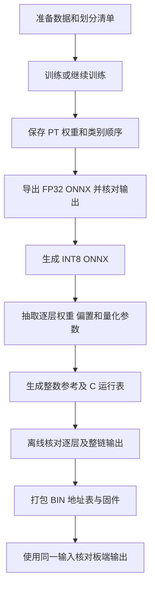

# 模型训练完成后，怎样进入板端工程

本页说明训练文件与板端模型文件之间的关系，并记录本次核对到的来源。新手先完成[模型构建说明](readme.md)，需要运行现成系统时按[从零复现指南](../../reproduce.md)操作。

**本包提供训练与数据处理代码，也提供已经转换好的板端模型资产。新训练得到的 `.pt` 权重，尚不能通过本包中的一个命令完整转换为当前板端资产。** 原工作区存在转换代码，但它们分散在多个实验目录，依赖旧量化模板、生成表和数据路径；本次没有把这些依赖不完整的脚本包装成“训练后自动上板”。

## 1. 先区分三种文件

| 文件 | 通俗解释 | 当前放在哪里 |
| --- | --- | --- |
| `.pt` | 训练程序学到的参数，交给 PyTorch 使用 | 运行训练后写入自己的输出目录；完整历史训练权重未随本包提供 |
| `.onnx` | 导出的模型计算图；FP32 版使用浮点数，INT8 版包含量化参数 | 历史文件位于原模型/部署工作区，未随本包提供 |
| `.bin` 与配套 `.h` | 板端需要的权重字节、偏置、输入示例、运算参数和地址表 | [模型资产目录](../../data/models/)、[运行时生成文件](../platform/runtime/generated/) |

`.bin` 文件名是编号，文件含义由[资产清单](../../data/models/assets_manifest.json)中的 `name`、`address`、`bytes`、`sha256`、`path` 共同说明。不要按照文件编号猜模型、删除看不懂的文件，或用 `.pt` 改后缀替换它。

目前共有 **391 个清单项**：音频 107 项、图像 107 项、检测 177 项。其中 3 项是预处理后的输入示例，另外 **388 项是权重或偏置**。构建启动镜像时使用的是这些现成参数。[构建说明](../../build/readme.md)中的 BOOT 构建不会训练模型，也不会把新的 `.pt` 自动转成它们。

## 2. 当前三个模型分别是什么

| 任务 | 网络和输入 | 训练产物的作用 | 当前板端参数 |
| --- | --- | --- | --- |
| 鸟声音频分类 | MobileNetV2；声谱图转换成 128 × 400 × 3 | 输出 60 个鸟类的分类分数 | 52 个卷积层的权重/偏置，以及分类头，共 106 项 |
| 鸟类图像分类 | MobileNetV2；128 × 128 RGB | 输出同样顺序的 60 个鸟类分数 | 52 个卷积层的权重/偏置，以及分类头，共 106 项 |
| 鸟类目标检测 | SSDlite + MobileNetV2；320 × 320 RGB | 区分背景和鸟，输出位置与置信度 | 88 个卷积层的权重/偏置，共 176 项；运行表还描述 10 个残差加法 |

当前音频部署模型不是早期 CoordinateNet/GAP 研究网络。当前图像部署模型采用 MobileNetV2，不是旧文件中保留的 `SmallBirdCNN` 选项。检测任务中的“鸟”是一个前景类别，不能把分类任务的 60 类直接套到检测头上。

音频和图像类别表必须使用同一个顺序。原始 `classes.txt` 与 `img_classes.txt` 本次按文件核对完全相同，均为 60 类；本包[上位机类别表](../pc/av_monitor/classes.json)的列表内容和顺序也与之相同。重新选类、增加类别、改变排序后，即使训练能够完成，也需要同步生成分类头、类别显示和运行参数。

## 3. 从训练到部署的实际流程

这张图描述完整工程应经过的阶段。**本次新增的可运行模型构建入口覆盖数据准备和训练；包内的固件构建入口使用已冻结的部署资产。图中间的模型转换阶段仍需要原工作区依赖，并未在全新路径完成端到端移植验证。**

### 3.1 音频与图像分类的历史转换路线

1. 训练得到 MobileNetV2 权重，固定类别顺序和预处理方式。
2. `export_onnx_v1.0.py` 同时导出两个 FP32 ONNX，保存参考输入和 PyTorch 分数，再用 ONNX Runtime 核对导出结果。脚本设置 opset 18。
3. `quantize_int8_v1.0.py` 生成 QDQ INT8 ONNX。QDQ 是在计算图中显式写出“量化/反量化”的表示，包含转换比例和零点，不只是把所有数强行变成整数。
4. 音频的逐层抽取脚本分别提取卷积、残差加法、分类头；图像有对应的抽取和表生成脚本。
5. 生成面向当前运行程序的整数参考、层表、权重地址、分类头参数；最后挑选推理必需的文件进入包内资产清单。

原脚本的校准样本从验证集选取，数量设置为 500，另用验证集统计量化前后精度差。因此这份历史量化评估不能当作完全独立的最终测试集成绩。新实验应固定并记录训练、校准、验证、最终测试四种用途；如果改变划分或量化参数，应产生新版本的参考结果和运行表。

原导出/量化脚本还存在需要移植时修正的行为：路径包含原工作目录；图像预处理动态导入训练文件；导出器和量化工具版本未随每次输出完整锁定；部分检查失败只打印 `FAIL` 而不返回失败退出码。不能以“脚本退出了”代替确认比较结果通过。

### 3.2 当前检测模型的转换路线

当前检测资产来自 **在 face_v2 基础上继续用 CUB 数据训练的检查点**，不是目录中另一个较新的 face_v4 候选模型。

历史训练配置记录：继续训练 10 个 epoch，batch size 8，学习率 0.0001，seed 2276，冻结 BatchNorm，负样本比例 0.25。`ssdlite_cub_continue_v1.0.py` 在原模型目录中的当前内容与该训练运行保存的源码快照字节相同。训练入口及数据要求见[模型构建说明](readme.md)。

随后采用的是**固定旧量化参数、只更新权重和偏置**的路线：

1. 导出新权重的 FP32 原始检测头图；检测头包含 6 组分类输出和 6 组框回归输出。
2. 核对新旧 FP32 图中节点结构、锚框和未替换参数相同。
3. 以原 INT8 ONNX 为模板，保留其量化比例和零点；重新计算 88 个卷积层的权重和偏置，共替换 176 个张量。**这一步没有重新校准。**
4. 权重使用对称 INT8 的 `[-127, 127]` 范围，偏置使用 INT32；按最近偶数舍入，并检查偏置溢出。
5. 重新抽取逐层参数与整数参考，生成运行表，检查表中数值与旧表一致，再做原生 C 逐层及整链核对。
6. 在历史固定验证集上对比 FP32 与 INT8 检测结果，通过后生成旧地址布局下的参数分区。

这条路线之所以能够沿用旧表，是因为脚本逐项验证了相关约束。新训练改变结构、输入形状、类别数、锚框或量化尺度时，不能继续沿用这个结论。

历史检测量化记录包含 1108 张有鸟图像和 55 张背景图像，其预处理为归一化浮点 RGB 后双线性缩放。记录中的 `accuracy_passed=true`、88 卷积和 10 加法的原生检查通过，均属于当时离线结果；其中 `board_verified=false`。它不代表摄像头 RGB565 路径的重新测试，也不代表本次新训练已经达到同样结果。

## 4. 本次实际核对到的来源

核对日期为 2026-11-03。本次只读取脚本、配置、历史结果和文件，计算 SHA256，未重新训练、导出、量化或运行硬件。

### 4.1 权重及模型文件身份

以下历史路径用于定位来源，不是让复现者照搬的工作目录。路径中的版本目录只作为审计标识。完整权重和 ONNX 未随本包提供。

| 文件 | 原位置 | 本次计算的 SHA256 |
| --- | --- | --- |
| 音频训练权重 | `D:/SSW60/models/264b v2.1/mobilenet_v2_v100_torch_weights.pt` | `a09f2230d563bb3a73bbe9c9b80d5e6f251df15841abf6bb3f90fdd5f62c5430` |
| 图像训练权重 | `D:/SSW60/models/264b v2.1/img_v100_torch_weights.pt` | `569f129d07808aa9e3676da03dee8b3abca95b0381cd632668cb21767dcc50a7` |
| 当前检测训练权重 | 模型仓库 `runs/ssdlite_cub_face_v2_v1_20261021/best_weights.pt` | `5ba600cd2e4a8d52422a6a8a8f2e7687fd4843108be4c4c60aeb3ab33cb08059` |
| 音图共同类别顺序 | `D:/SSW60/models/264b v2.1/classes.txt` | `d8aa1a6c4f9f39d61e29e96354f39031cf0f7306cdc47aee2cb62d5c0cf79f1b` |
| 音频 INT8 ONNX | 上述模型目录下 `onnx/audio_mobilenet_v2_v100_int8.onnx` | `8b1bae5c9c1247c530a702717218b39236102c200b6047f707b706b4b280947f` |
| 图像 INT8 ONNX | 上述模型目录下 `onnx/image_mobilenet_v2_v100_int8.onnx` | `20d8f9e67e3e3a81b9b49a669c9b4fe4c23a5da52e40cdbc6cb6b89feb192278` |
| 检测 INT8 ONNX | 工作区 `m38_cub_fixed_old_quant_20261021/ssd/ssd_raw_int8.onnx` | `c2f9d35a2ff5f90a248914f0f34148b1240863d8c3bc8957882ec4a04801abf6` |

音图脚本明确读取表中对应权重。当前包内的音频 107 项、图像 107 项，均与[历史运行时清单](../platform/runtime/generated/manifest.json)所指的**实际原文件**重新计算 SHA256 后完全一致。本次没有重新导出这两个检查点，也没有找到包含当时输入检查点哈希的完整导出回执，因此该核对证明“资产与原文件一致”，不能进一步声称“已经从这两个现存 PT 文件重新生成并逐字节证明全部资产一致”。

检测路径的对应关系更完整：原转换回执记录的检查点 SHA256 与现存文件一致，包内 **176 个检测权重/偏置的名称和 SHA256 全部匹配**该转换目录的 `ssd/build/runtime_manifest.json`。包内 `ssd_table.h` 与其旧参数表在统一换行后文本完全相同；两者原始文件 SHA 不同，不宣称字节相同。

### 4.2 检测继续训练与固定模板的追溯信息

| 依赖 | 已核对的信息 |
| --- | --- |
| 继续训练的起点 | `runs/ssdlite_background_finetune_face_v2/best_weights.pt`；训练配置记录初始 SHA `5f98d480fc2db91827caee73e5b46bb14608fd02051265565773058dc1ea84ee` |
| CUB 训练配方 | 原模型文件和该运行的 `source_snapshot/ssdlite_cub_continue_v1.0.py` 均为 `4971abd2a09d359225b59c9c88df18c6cd8f9a8d1ee145af43e1b3eb042be213` |
| 固定 QDQ 模板 | `m9_visual_deploy/ssd/ssd_raw_int8.onnx`；实际 SHA `612d71c0ef6781653b993786328e7ea471a99f54b6f1b47e7988f5ba9702f301` |
| 旧检测参数表 | 原转换回执记录 SHA `bcae3bd6a2670868c39397154acbbc6cdfc66b7617fb391d5b37c75dbd04af63`；本次读取该表计算相同 |
| 包内检测参数表 | [ssd_table.h](../platform/runtime/generated/ssd_table.h)；SHA `d4de3282f71b691f34aa16225ee7b63476baac5c67672e99853175530385709f`；与上项文本相同，换行字节不同 |

历史配置和验证记录位于原模型仓库 `runs/ssdlite_cub_face_v2_v1_20261021/`，以及原部署工作区 `m38_cub_fixed_old_quant_20261021/ssd/` 的 `fixed_quantization_receipt.json`、`quantization_validation.json`、`native_validation.json`。本表将已读取到的关键身份记录下来；这些历史运行目录本身不在交付包内。

### 4.3 输入样例与预期结果必须单独核对

当前包内 `samples/ssd.bin` 仍匹配早期检测输入样例，与 CUB 固定量化运行用于原生检查的新样例不同。因此：

- 176 项参数匹配，不能自动证明两个运行使用了同一个输入。
- CUB 转换记录的原生检查结果不能直接套到包内检测样例上。
- 包内[expected.json](../../data/models/samples/expected.json)的检测参考为 anchor 3231/444；它与上述 CUB 原生记录不同，本次未找到把该参考与当前完整模型、输入和运行版本同时关联的生成回执。这里保留“待关联核实”，不将不同样例的结果判为模型错误。

已有[输出比较器](../../sim/compare_inference.py)可以检查捕获结果的格式和数值，但比较器自身测试通过不等于参考来源已经获得新实测验证。样例边界见[样例说明](../../data/models/samples/readme.md)。补充实测时应同时保留输入哈希、388 项参数清单哈希、固件版本、原始输出和独立参考来源。

## 5. 若要补齐新权重到板端的便携转换，需要哪些代码

下表是本次读取源码后得到的迁移清单，**不是当前包内可直接运行的命令列表**。它用于避免只复制一个导出脚本，却遗漏生成表、参考实现或模板依赖。

| 阶段 | 已有原始实现 | 迁移时必须一起处理 |
| --- | --- | --- |
| 音图 FP32 导出和 INT8 量化 | 模型仓库 `scripts/export_onnx_v1.0.py`、`quantize_int8_v1.0.py` | 将工作目录、权重、类别表、数据清单、校准划分、输出目录设为参数；锁定工具版本；失败退出码；记录输入和输出哈希 |
| 音频逐层抽取 | 模型仓库 `scripts/extract_golden_layers_v1.0.py`、`extract_golden_adds_v1.0.py`、`extract_golden_head_v1.0.py` | ONNX 节点及形状假设、卷积/残差/头部参数、整数偏置、真实样例与类别顺序 |
| 图像抽取与整数参考 | 工作区 `m7_tools/extract_image_golden.py`、`extract_image_adds.py`、`extract_image_head.py`、`generate_image_tables.py`；`m9_visual_deploy/image_reference.py` | 去除固定目录，保留独立整数卷积、残差和分类头的算法核对 |
| 检测 FP32 和初始校准导出 | `m9_visual_deploy/ssd/export_quantize.py`、`evaluate_quantized.py` | SSD 构造器、`train_bird_detector.py`、图像清单、预处理、原始头输出和锚框；重新校准会生成新参数表需求 |
| 当前检测固定量化路径 | `m38_cub_fixed_old_quant_20261021/quantize_fixed.py` | 原 FP32/INT8 模板、旧表、当前 PT、锚框、结构一致性断言；不能用任意 ONNX 替换模板 |
| 检测逐层和 C 核对 | `m9_visual_deploy/ssd/extract_golden.py`、`integer_reference.py`、`prepare_runtime.py`、`check_native.py`；共享 `image_reference.py` | 原生 C 数学库须从源码构建；删除对历史预编译 `ps_math.dll` 的依赖；分离生成数据与仿真脚手架 |
| 统一运行表和资产布局 | `m10_unified_runtime/prepare.py`、`release_tools/package_minimal.py` | 地址不重叠、参数长度、推理资产选择、类别表、输入约定；解除从早期 `main.c` 切片/文本替换生成新程序的依赖 |

这些代码有明确的历史用途，但部分会在导入时创建目录，依赖其它实验的 C 文件/仿真文件，或把旧固件分区作为打包输入。某些其它候选流程还包含 SD 卡路径。正式移植应先把“离线模型转换”做成独立入口，输出到新的空目录，再由现有构建入口显式采用新资产；不应直接启动旧实验总脚本。

ONNX 的逐层输出与板端整数运算也不能默认逐字节相同。现有整数参考明确处理固定点乘数、最近偶数舍入和饱和，历史记录中存在由量化/舍入差异导致的少量 1 LSB 差别。迁移时应保存差异位置、累计值、量化参数及依据，再验证与板端同一数学约定的整数参考；不能把所有差异都设成无条件容差通过。

## 6. 新手现在可以做到哪一步

| 你的目标 | 操作入口 | 完成标志 |
| --- | --- | --- |
| 不训练，先复现现成系统 | [从零复现指南](../../reproduce.md) | 按各阶段检查日志和产物；当前实测边界以指南为准 |
| 了解并构建三个模型，准备数据、启动训练 | [模型构建说明](readme.md) | 训练实际运行后得到自己输出目录中的权重、配置和日志；帮助命令或冒烟检查不等于完整训练完成 |
| 修改分类数或训练自己的鸟类模型 | 按训练说明使用新的数据与输出目录 | 先确认模型在自己固定的验证/测试集上有效；随后另行完成第 5 节转换与验证 |
| 重新制作现成参数的固件 | [构建说明](../../build/readme.md) | 固件构建和资产核对通过；这一步不会证明新训练权重可直接替换 |
| 把自己新训的模型放到板上 | 第 3、5 节所列工程链 | 目前仍需完成便携转换、参数表生成、独立参考和板端核对，不能仅替换一个文件宣布成功 |

重新训练时至少保存：数据来源及许可、划分清单、类别顺序、模型源码版本、初始权重哈希、随机种子、依赖版本、完整配置、最终权重哈希和评估日志。继续训练已有检测模型还需要合法取得其起始权重；没有该起点时，可以训练新模型，但不能宣称逐字节复现现有检查点。

本次增加模型代码的目的，是让读者能够看清并执行模型构建步骤。当前确认的事实是代码、历史来源和现成部署资产之间的对应关系；本次未进行新训练，未重新导出全部模型，也未新增板端模型精度结论。
